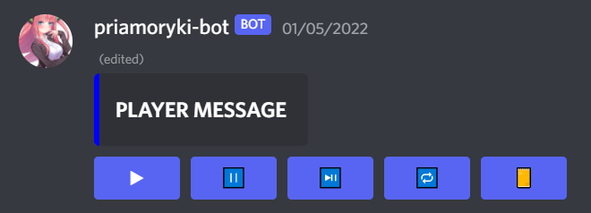
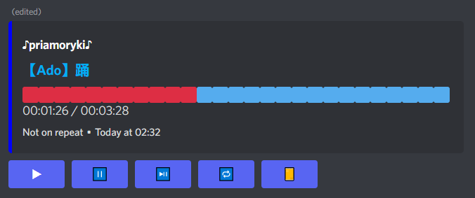

# priamoryki-bot

A Discord music bot built with Java, Spring Boot, JDA and Lavaplayer. It provides a music queue,
playback controls, audio effects and short sound commands. Server settings and YouTube authorization
are stored in SQLite, with optional synchronization to Yandex Disk.

[Invite the existing bot](https://discord.com/oauth2/authorize?client_id=848999847229915147&permissions=2167532560&scope=bot%20applications.commands).
To run your own instance, create a Discord application and generate an invitation for its client ID.

## Contents

- [Requirements](#requirements)
- [Discord setup](#discord-setup)
- [Configuration](#configuration)
- [Run locally](#run-locally)
- [Run with Docker Compose](#run-with-docker-compose)
- [YouTube authorization](#youtube-authorization)
- [Signature cipher](#signature-cipher)
- [Database and persistence](#database-and-persistence)
- [Using the bot](#using-the-bot)
- [Troubleshooting](#troubleshooting)
- [Development](#development)

## Requirements

- **JDK 25** to build and run locally. Set the IDE project SDK and Maven runner JDK to 25 as well.
- **Maven 3** on `PATH`, or the Maven bundled with your IDE. This repository has no Maven wrapper.
- A Discord bot token and a Discord server where you can install the bot.
- Spotify application credentials for resolving Spotify links.
- Network access to Discord, the music providers and, when enabled, Yandex Disk and a cipher service.
- Docker with Docker Compose only for the container-based deployment. Docker is not required to run
  the Java application with an external cipher service.

Run commands from the repository root: database paths and the `sounds/` directory are relative to it.

## Discord setup

1. Create an application in the [Discord Developer Portal](https://discord.com/developers/applications)
   and obtain its bot token. Use it as `TOKEN`.
2. Enable **Message Content Intent** in the application's Bot settings. The code explicitly requests
   this intent; see [Discord's privileged intent documentation](https://docs.discord.com/developers/events/gateway#privileged-intents).
3. Invite your application with the `bot` and `applications.commands` scopes. Grant access to the
   intended text and voice channels, including creating channels, sending messages and embeds,
   reading message history, deleting and pinning messages, attaching files, connecting and speaking.
4. Set `BOT_AUTHOR_ID` to your numeric Discord **user ID**, not the application or server ID. Enable
   Developer Mode in Discord to copy it. Multiple author IDs can be comma-separated; the first one
   receives YouTube authorization messages and error notifications.
5. Allow direct messages from the bot so that the YouTube sign-in code can reach you.

Use a separate Discord application/token for development if the production bot is already running.

## Configuration

### Environment variables

| Variable | Purpose | When to set it |
| --- | --- | --- |
| `TOKEN` | Discord bot token | Required to connect to Discord. |
| `BOT_AUTHOR_ID` | One or more comma-separated numeric Discord user IDs | Required; the first ID is the notification recipient. |
| `YADISK_TOKEN` | Yandex Disk OAuth token | A valid token is needed with `db.sync=true`. The current constructor still requires this variable with sync disabled; use a nonempty placeholder such as `unused` in that case. |
| `SPOTIFY_CLIENT_ID` | Spotify application client ID | Set together with the secret for Spotify links. |
| `SPOTIFY_CLIENT_SECRET` | Spotify application client secret | Read directly from the process environment, as is the client ID. |
| `YT_CIPHER_URL` | Base URL of a reachable signature cipher service | Optional in Java; an empty value uses the library's local deciphering. Compose sets it to `http://yt-cipher:8001`. |
| `YT_CIPHER_TOKEN` | Password shared with the cipher service | Set for the supplied Compose deployment or any cipher server requiring authentication. Leave unset/empty for a server without authentication. |

Obtain a [Yandex OAuth token](https://yandex.ru/dev/id/doc/ru/concepts/ya-oauth-intro) with access to the
configured Disk location, and create a [Spotify application](https://developer.spotify.com/documentation/web-api/concepts/authorization)
for its client credentials. `YT_CIPHER_TOKEN` is a password you choose, not a Google token.

For Docker Compose, create an untracked `.env` file in the repository root:

```dotenv
TOKEN=replace-with-discord-bot-token
BOT_AUTHOR_ID=123456789012345678
YADISK_TOKEN=replace-with-yandex-disk-token
SPOTIFY_CLIENT_ID=replace-with-spotify-client-id
SPOTIFY_CLIENT_SECRET=replace-with-spotify-client-secret
YT_CIPHER_TOKEN=choose-a-private-cipher-password
```

The placeholders must be replaced before connecting to the corresponding services. YouTube sign-in
is handled by the application; no manually supplied YouTube token or Google password is needed.

**A `.env` file is not loaded automatically by this Java application.**
[Compose reads it for variable interpolation](https://docs.docker.com/compose/how-tos/environment-variables/variable-interpolation/),
but an IDE or terminal launch needs environment variables configured separately. Only variables
listed in the Compose service's `environment` block are passed through from this file; adding an
arbitrary Spring setting to `.env` alone does not configure the container.

### Application profiles

Configuration lives in [application.properties](src/main/resources/application.properties), with
overrides in [application-local.properties](src/main/resources/application-local.properties).
There is no `data/config.json` configuration file.

| Setting | Default profile | `local` profile |
| --- | --- | --- |
| `bot.name` | `priamoryki-bot` | `priamoryki-bot` |
| `bot.prefix` | Empty | Empty |
| `db.local.path` | `data/servers.db` | `data/test-servers.db` |
| `db.server.path` | `app:/servers.db` | `app:/test-servers.db` |
| `db.sync` | `true` | `true` |
| SQL logging | Disabled | Enabled |
| Bot package logging | Inherited default | `DEBUG` |

`bot.name` controls the text channel name. `bot.prefix` controls text commands; it does not change
slash command names. The `local` profile does **not** disable cloud synchronization or configure a
cipher service automatically.

For a local database without Yandex Disk access, use `--db.sync=false`. This is a Spring Boot program
argument, not a JVM option. See [Spring Boot configuration](https://docs.spring.io/spring-boot/4.0/reference/features/external-config.html)
for other ways to override properties.

## Run locally

### From an IDE

1. Import `pom.xml` as a Maven project and select JDK 25.
2. Create an Application/Spring Boot run configuration for
   `com.priamoryki.discordbot.ApplicationMain`.
3. Set its working directory to the repository root and add the environment variables described
   above. Use `YADISK_TOKEN=unused` when disabling synchronization.
4. Set program arguments to `--spring.profiles.active=local --db.sync=false`.
5. Configure `YT_CIPHER_URL` for YouTube playback; see [Signature cipher](#signature-cipher).
6. Run or debug `ApplicationMain`. The saved configuration can be reused with the IDE's Run button.

The application does not start a cipher server itself. For development without local Docker, use an
external cipher endpoint or run the cipher service separately with Deno.

### From a terminal

Set process environment variables first. These examples disable Yandex Disk synchronization and
use the public cipher endpoint described below; supply your own Discord and Spotify credentials.

PowerShell:

```powershell
$env:TOKEN = "replace-with-discord-bot-token"
$env:BOT_AUTHOR_ID = "123456789012345678"
$env:YADISK_TOKEN = "unused"
$env:SPOTIFY_CLIENT_ID = "replace-with-spotify-client-id"
$env:SPOTIFY_CLIENT_SECRET = "replace-with-spotify-client-secret"
$env:YT_CIPHER_URL = "https://cipher.kikkia.dev/"
$env:YT_CIPHER_TOKEN = ""
```

Bash:

```bash
export TOKEN="replace-with-discord-bot-token"
export BOT_AUTHOR_ID="123456789012345678"
export YADISK_TOKEN="unused"
export SPOTIFY_CLIENT_ID="replace-with-spotify-client-id"
export SPOTIFY_CLIENT_SECRET="replace-with-spotify-client-secret"
export YT_CIPHER_URL="https://cipher.kikkia.dev/"
export YT_CIPHER_TOKEN=""
```

Build and run; the same commands work in either shell:

```shell
mvn -B package
java -jar target/DiscordBot-1.0.jar --spring.profiles.active=local --db.sync=false
```

On first authorization, follow the code sent by the bot. The SQLite database is created through Hibernate
when synchronization is disabled and the application initializes successfully.

## Run with Docker Compose

Prepare `.env`, then check [Database and persistence](#database-and-persistence) before deploying:
the default profile enables Yandex Disk synchronization and the supplied Compose file has no data volume.

```shell
docker compose up --build -d
docker compose logs -f priamoryki-bot yt-cipher
```

This builds the Java application inside the Maven/JDK 25 image and starts both the bot and
`yt-cipher`. You do not need Java or Maven installed on the host for this route.

Useful maintenance commands:

```shell
docker compose ps
docker compose restart priamoryki-bot
docker compose pull yt-cipher
docker compose up --build -d
```

`restart` reuses the existing container; use `up --build -d` after source or environment changes.
The cipher image uses the moving `master` tag, so `pull` may change its behavior independently of
the bot's Java dependencies. `depends_on` starts the cipher container first but does not provide
an application-level readiness check in this Compose file.

## YouTube authorization

YouTube OAuth is always enabled, including in the `local` profile. Signing in can help with videos
requiring an account, but does not guarantee that every YouTube request or video will work. The upstream
[youtube-source documentation](https://github.com/lavalink-devs/youtube-source#using-oauth-tokens)
recommends a dedicated account because YouTube may restrict automated access.

On every application start, the flow is:

1. Look for the saved refresh token in the active SQLite database's `youtube_auth` table.
2. If present, initialize YouTube OAuth with that token.
3. Otherwise, start authorization in a background thread and send the first `BOT_AUTHOR_ID` a direct
   message with a verification URL and code. The URL/code also appear in application logs.
4. Open the URL, normally [google.com/device](https://www.google.com/device), and approve the code
   using the account intended for the bot.
5. Save the resulting refresh token to the database and send a completion message.

Subsequent starts reuse the token from that database. The `local` and default profiles use different
database files, so authorizing one does not automatically authorize the other. With `db.sync=true`,
the token is included in the database uploaded to Yandex Disk. It survives container recreation only
if the database is successfully restored or otherwise persisted.

If the code expires, restart the bot to request another one. A revoked token already stored in the
database does not currently trigger automatic reauthorization: after stopping the bot and backing
up the database, clear the `youtube_auth` record in the database that will actually be loaded on the
next start. With cloud sync enabled, changing only the local copy can be undone by the startup download.

## Signature cipher

OAuth and signature deciphering solve different problems. OAuth signs the bot into an account;
the cipher decodes protected stream URLs. A valid account token does not fix a broken decipherer.

The Java configuration uses a remote cipher when `YT_CIPHER_URL` is nonempty. If it is empty, it falls
back to the library's local deciphering, which can fail when YouTube changes its player script,
for example with `Must find sig function from script`.

In Docker Compose, the bot connects to `http://yt-cipher:8001` on the container network. This hostname
is not available to an ordinary IDE process, and the supplied Compose file does not publish port
8001 to the host. The services share `YT_CIPHER_TOKEN` through the cipher's `API_TOKEN` variable;
the cipher is configured with `OVERRIDE_PLAYER_VARIANT=IAS`.

For a Java process outside Docker, set a URL reachable from that process. The
[yt-cipher project](https://github.com/kikkia/yt-cipher#readme) documents a public endpoint at
`https://cipher.kikkia.dev/` without a password, and direct hosting with Deno. The public endpoint
is rate-limited and has no uptime guarantee. Leave `YT_CIPHER_TOKEN` unset/empty when using it;
use the appropriate password for a private instance.

## Database and persistence

SQLite stores server/channel/message IDs and the YouTube refresh token. Hibernate updates the schema
on startup. Playback queues and history live in memory and are not restored from SQLite.

With `db.sync=true`, `YaDiskFileLoader` attempts to replace the local database with the configured
Yandex Disk file during startup. Repository saves mark it for upload, and `SyncService` checks for
pending uploads every 10 seconds. Synchronization errors are logged; this is not a guarantee that
every change has reached the cloud before shutdown.

For a fresh local setup, use `db.sync=false` to create and use the local database without needing an
existing cloud copy. Before enabling synchronization, prepare the corresponding file at
`db.server.path` using the configured Yandex application credentials. Avoid running multiple instances
against the same remote database path: synchronization transfers the whole file and does not merge changes.

The current Docker setup has two persistence details to account for:

- The Compose file declares **no bind mount or named volume** for the bot's database. Container
  recreation can discard runtime database changes unless they are restored from Yandex Disk.
  If you disable sync for a container deployment, configure persistent storage for the data directory.
- The Dockerfile copies the host `data/` directory into the image. A local `.db` file in that directory
  can therefore be included in the image, even though Git ignores it. A Git ignore rule does not
  exclude files from a Docker build.

Back up the database with the bot stopped. Treat database backups as containing credentials because
they include the YouTube refresh token. Keep local development and production databases separate.

## Using the bot

The bot creates its own text channel and pinned control messages. If the channel was deleted,
mention the bot in a server text channel to recreate it. Send commands in the bot's channel; text
messages there are removed as part of keeping the control channel tidy.

Join a voice channel, use `/join`, then `/music` with a video URL or search query. Most playback
commands require you to be in the same voice channel as the bot. Slash command options are shown
by Discord; text commands use the configured prefix, which is empty by default.

| Commands | Purpose |
| --- | --- |
| `/join`, `/leave` | Connect to or leave your voice channel. |
| `/music`, `/play_next` | Add a URL/search result to the queue or place it next. |
| `/skip`, `/skip_to`, `/seek` | Move between tracks or seek within the current track. |
| `/queue_print`, `/queue_shuffle`, `/queue_delete` | Inspect and edit the queue. |
| `/queue_clear` | Clear the queue and skip the current track. |
| `/history`, `/repeat` | Inspect recent playback or set the repeat option. |
| `/bassboost`, `/nightcore`, `/speed`, `/reset` | Change or reset audio effects. |
| `/cycle`, `/uncycle` | Enable or disable cycling of the current track. |

Pause/resume and pagination are available through message buttons. Sound commands use the bundled
files in `sounds/`. Spotify and Yandex Music links resolve metadata into SoundCloud searches in the
current implementation; they do not stream audio directly from those services, so matches may differ.

Idle player message:



Running player message:



## Troubleshooting

| Symptom | What to check |
| --- | --- |
| `release version 25 not supported` or unsupported class version | Check `java -version`, `mvn -version`, the IDE SDK and Maven runner JDK. Use JDK 25. |
| `Could not resolve placeholder` for a credential | Set the variable in the environment of the process actually launching Java. A Compose `.env` is not automatically an IDE configuration. |
| Yandex errors during a local run | The `local` profile still enables sync. Pass `--db.sync=false` and set `YADISK_TOKEN=unused` to work without it. |
| Discord rejects an intent or messages are not read | Enable Message Content Intent in the Developer Portal and check channel permissions. |
| No YouTube authorization message | Check the first `BOT_AUTHOR_ID`, direct-message access and logs. A stored token skips the device-code flow. |
| YouTube asks for sign-in | Complete authorization for the active profile's database; a stored revoked token may require the recovery described above. |
| Signature extraction errors | Verify that `YT_CIPHER_URL` points to a reachable service. Account authorization alone does not fix signature extraction. |
| Cipher connection errors from the IDE | `yt-cipher` is a Compose-internal hostname and port 8001 is not published. Use an endpoint reachable from the host. |
| Cipher rejects authentication | Match `YT_CIPHER_TOKEN` to the private server's `API_TOKEN`, or leave it empty for the public endpoint. |
| Data or authorization disappears after container recreation | Check cloud upload/download errors and database persistence. The supplied Compose file has no data volume. |
| Commands are ignored or report a voice-channel mismatch | Use the bot's text channel and join the same voice channel as the bot. Use `/join` before playback commands. |

## Development

Build the executable JAR:

```shell
mvn -B package
```

The result is `target/DiscordBot-1.0.jar`. Packaging does not start the bot or verify live Discord,
OAuth or music playback. The YouTube library is currently pinned to a commit-based `-SNAPSHOT` in
`pom.xml`; resolving it requires the configured Lavalink snapshots repository.

| Location | Responsibility |
| --- | --- |
| [ApplicationMain](src/main/java/com/priamoryki/discordbot/ApplicationMain.java) | Spring Boot entry point. |
| [configs](src/main/java/com/priamoryki/discordbot/configs) | Discord, audio sources and persistence configuration. |
| [commands](src/main/java/com/priamoryki/discordbot/commands) | Slash/text commands and button actions. |
| [api/audio](src/main/java/com/priamoryki/discordbot/api/audio) | Playback, queues, searching and custom sources. |
| [api/events](src/main/java/com/priamoryki/discordbot/api/events) | Discord event handling. |
| [api/messages](src/main/java/com/priamoryki/discordbot/api/messages) | Player and queue messages. |
| [YoutubeAuthService](src/main/java/com/priamoryki/discordbot/common/auth/service/YoutubeAuthService.java) | Device-code authorization and token persistence. |
| [common/sync](src/main/java/com/priamoryki/discordbot/common/sync) | Yandex Disk database synchronization. |
| [api/database](src/main/java/com/priamoryki/discordbot/api/database) | JPA entities and repositories. |

[Build CI](.github/workflows/build.yml) packages the project with JDK 25 on pushes and pull requests
to `main`. The manual [deployment workflow](.github/workflows/deploy.yml) uses `HOST`, `USERNAME` and
`PASSWORD` GitHub secrets to connect over SSH, pull the server checkout and recreate the Compose
deployment. Its script currently invokes the legacy `docker-compose` command; the server must provide
that command or the workflow must be adapted to its Compose installation. Runtime credentials belong
in the server environment/`.env`, not in the workflow source.

Reuse is covered by [LICENSE](LICENSE). Report bugs in the
[issue tracker](https://github.com/priamoryki/priamoryki-bot/issues), including the relevant error and
active profile, with tokens removed from logs.
